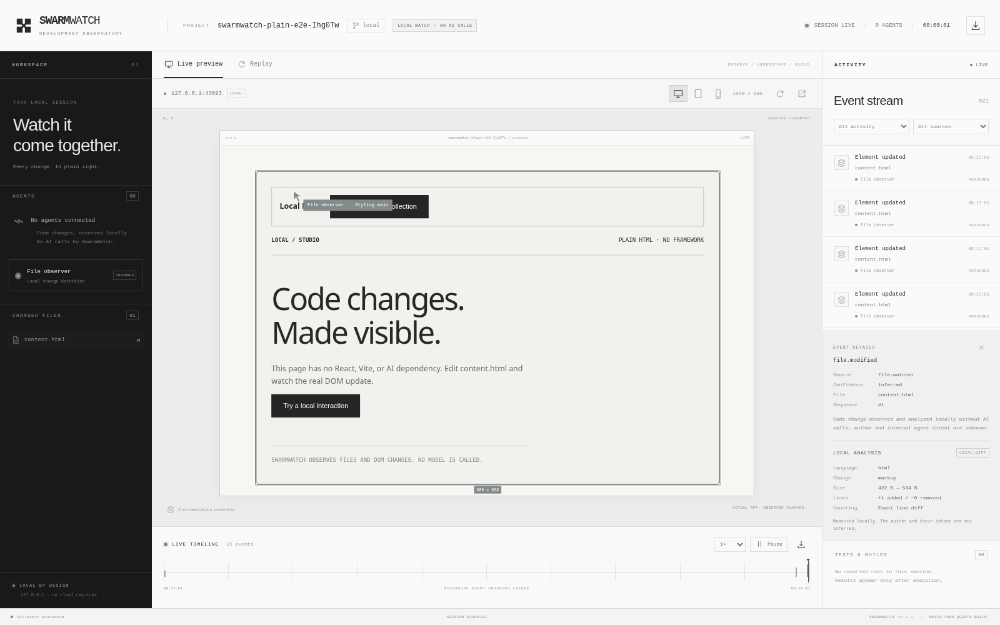

# SwarmWatch

**Watch your AI agents build a web application, live.**

프레임워크와 관계없이 **실제 파일 변경을 로컬에서 감지·분석**하는 개발 도구입니다. 기본 `watch` 모드는 **AI 호출과 API 키 없이** 동작합니다. 웹 앱을 연결하면 실제 DOM 변경 영역에 커서와 선택·타이핑 애니메이션도 표시합니다. 가상의 작업자나 확인되지 않은 AI 행동은 만들지 않습니다.

**0.1.0 MVP · Node.js 24+ · 로컬 실행 · MIT**

시각적 영감은 **[Joel Califa](https://github.com/califa)의 [Swarm](https://califa.github.io/swarm-site/)**, 참고 프로젝트는 **[Dhvanil / @DhvanilPatel](https://github.com/DhvanilPatel)의 [Swarm Rebuild](https://github.com/DhvanilPatel/swarm-cursors)**입니다. 원작의 코드·에셋을 포함하지 않은 독립 구현입니다. [원작자 및 출처](docs/credits.md) · [라이선스 구분](docs/third-party-notices.md)



## 설치 및 실행

지원 배포 방식은 **전체 소스 체크아웃**입니다. npm에 게시된 패키지나 전역 `npx swarmwatch` 설치를 전제로 하지 않습니다.

```bash
git clone https://github.com/Duioolllll/swarm-ai-edit.git
cd swarm-ai-edit
npm ci
npm run build

# Preview·프레임워크·AI 없이 파일만 관찰
node packages/cli/dist/index.js watch --project /absolute/path/my-app
```

대시보드는 `http://localhost:4317`이며 기본 바인딩은 `127.0.0.1`입니다. 파일을 생성·수정·삭제하면 종류, 크기, line 변경 통계와 이벤트가 나타납니다. 초기 scan은 작업으로 표시하지 않습니다.

프레임워크 없는 **Plain HTML 샘플**로 실제 파일 → DOM → 커서 파이프라인을 보려면:

```bash
npm run demo:plain
```

샘플은 `http://127.0.0.1:5180`에서 실행됩니다. `examples/plain-app/content.html`을 수정하세요. 이 예제의 작은 로컬 runtime이 변경 내용을 실제 DOM에 반영하고 별도 bridge가 이를 측정합니다. SwarmWatch가 임의 앱에 HMR을 자동 추가하는 것은 아닙니다.

`npm run dev` 또는 `npm run demo`는 선택적인 React + Vite 예제를 5173에서 실행합니다. 모든 기본 스크립트는 `watch`를 사용하며 에이전트를 시작하지 않습니다. `Ctrl+C`는 SwarmWatch가 시작한 프로세스를 종료합니다.

## 주요 기능

| 기능 | 지원 범위 |
| --- | --- |
| 파일 관찰 | JS/TS, HTML, CSS, Vue/Svelte/Astro, 서버 template, data·asset 확장자 |
| 로컬 분석 | `local-diff` byte·line 통계, bounded 메모리, source snippet 미저장 |
| 실제 Preview | 임의 로컬 웹 앱 연결, Desktop / Tablet / Mobile |
| 변경 시각화 | 수동 범용 bridge 또는 Vite plugin, 실제 DOM 좌표의 커서·선택·텍스트·이미지·삭제 trace |
| 기록 | SQLite 세션, 중복 제거, WebSocket 복구, JSON export |
| Replay | 시간 탐색, pause/resume, 1×/2×/4×, 종류·에이전트 필터 |
| 선택적 agent 수집 | 명시적 `dev --allow-agents`에서 Codex JSONL / OpenCode v1 SSE |

파일 작성자는 **File observer / inferred**로 표시합니다. DOM 위치는 실측하지만 범용 파일 연결은 추정입니다. 정확한 대상이나 작성자를 모르면 특정 컴포넌트나 AI 의도를 임의로 지목하지 않습니다.

## 내 프로젝트 연결

기존 개발 서버를 함께 보거나 명시적으로 실행할 수 있습니다.

```bash
node packages/cli/dist/index.js watch --project /absolute/path/my-app \
  --url http://127.0.0.1:5173

node packages/cli/dist/index.js watch --project /absolute/path/my-app \
  --url http://127.0.0.1:5173 -- npm run dev -- --host 127.0.0.1
```

범용 DOM 관찰은 앱의 개발용 HTML/layout에 script를 **직접 추가**합니다. plugin·React·module loader는 필요하지 않습니다.

```html
<script src="http://127.0.0.1:4317/bridge.js"></script>
```

대시보드에서 **Instrumentation connected**를 확인하세요. script가 없는 앱은 실제 Preview와 파일 분석을 제공하며 DOM 대상은 알 수 없습니다. React + Vite는 선택적 plugin으로 더 정확한 JSX 파일 mapping과 HMR 정보를 제공합니다. [파일 관찰과 범용 bridge](docs/file-watch.md) · [Vite 설치 및 상세 사용법](docs/usage.md)

## AI 호출의 경계

`watch`는 `--codex`, `--opencode`, `--allow-agents`를 프로세스 시작 전에 거부합니다. `SWARMWATCH_NO_AI=1`은 `dev`에서도 agent opt-in을 차단합니다. 관찰·diff 분석은 deterministic local 코드이며 LLM에 위임하지 않습니다.

선택적으로 `dev --allow-agents --codex PROMPT` 또는 `--opencode URL`을 사용하면 외부 에이전트와 연결되며 공급자 토큰·요금이 발생할 수 있습니다. 별도로 실행 중인 AI 도구, 앱 자체의 API, `--` 뒤에 사용자가 전달한 명령의 비용은 SwarmWatch의 기본 관찰 범위 밖입니다. 프로젝트 전체의 AI 비용이 0이라는 뜻은 아닙니다.

## 검증

```bash
npm run build
npm run typecheck
npm test
npm run test:e2e
```

브라우저 테스트는 `/usr/bin/chromium` 또는 `CHROMIUM_PATH`를 사용합니다. [브라우저 준비](docs/deployment.md#검증용-브라우저) · [최신 검증 결과](docs/test-results.md)

자동화는 파일·로컬 diff, no-AI 옵션 거부, 실제 Plain HTML DOM과 Vite HMR·커서, 일반 입력 억제, 재연결·Replay를 검사합니다. 실제 provider 인증 실행은 검증하지 않았습니다.

[Local Watch](artifacts/swarmwatch-local-watch.png) · [Vite Live](artifacts/swarmwatch-live.png) · [Replay](artifacts/swarmwatch-replay.png) · [Mobile Preview](artifacts/swarmwatch-mobile-preview.png)

## 현재 제한

- 파일 관찰은 폭넓은 확장자를 지원하지만 모든 언어의 의미·컴포넌트 구조를 분석하지 않습니다. bounded source snapshot은 메모리에만 보관하며 원문은 저장하지 않습니다. 한계로 line 계산이 불가능하면 `null`, 계산량 초과 시 명시적 replacement fallback입니다.
- 범용 bridge의 source correlation과 CSS 연결은 추정이며 정확한 인과관계의 증명이 아닙니다. 앱 자체의 갱신 runtime은 필요합니다. full reload 최초 화면은 새 baseline입니다.
- Replay는 이벤트와 측정 geometry를 재생합니다. 과거 HTML·CSS·미디어 snapshot은 없고 iframe은 현재 앱입니다.
- 인증된 Codex/OpenCode 실행, Codex 협업 receiver thread별 커서, Next.js 전용 자동 mapping, 원격 Preview와 일반 npm 배포는 미검증 또는 미지원입니다. 기본 파일 감지는 Next.js 프로젝트에서도 확장자 기준으로 동작합니다.
- 기본 데이터는 `<project>/.swarmwatch`에 저장합니다. DOM 직접 텍스트가 기록될 수 있으므로 민감 영역은 `data-sw-private`로 제외하고 export 전에 확인하세요. redaction은 최선의 노력입니다.

## 문서

[파일 관찰](docs/file-watch.md) · [상세 사용법](docs/usage.md) · [배포](docs/deployment.md) · [변경 기록](CHANGELOG.md) · [아키텍처](docs/architecture.md) · [Adapter 개발](docs/adapters.md) · [공식 인터페이스 조사](docs/adapter-research.md) · [참고 분석](docs/reference-analysis.md)

## 원작자와 라이선스

- **Joel Califa / [@califa](https://github.com/califa)** — [Swarm](https://califa.github.io/swarm-site/), 멀티 커서·제작 모션 콘셉트의 원작자. [원본 저장소](https://github.com/califa/swarm-site)
- **Dhvanil / [@DhvanilPatel](https://github.com/DhvanilPatel)** — [Swarm Rebuild / swarm-cursors](https://github.com/DhvanilPatel/swarm-cursors), 페이지 DOM 스냅샷·재구성 참고 프로젝트 제작자.
- **[Duioolllll](https://github.com/Duioolllll) 및 SwarmWatch contributors** — 실제 개발 이벤트를 연결하는 본 프로젝트의 독립 구현.

SwarmWatch 자체 코드는 [MIT License](LICENSE)로 제공합니다. 참고 프로젝트에는 조사 시점에 명시적인 재사용 라이선스가 없었으며, 이 저장소의 MIT는 원작의 재사용 권한을 부여하지 않습니다. 코드·에셋을 복사하지 않았으며 원작자와의 제휴나 보증을 의미하지 않습니다. [Credits](docs/credits.md) · [Third-party notices](docs/third-party-notices.md)
