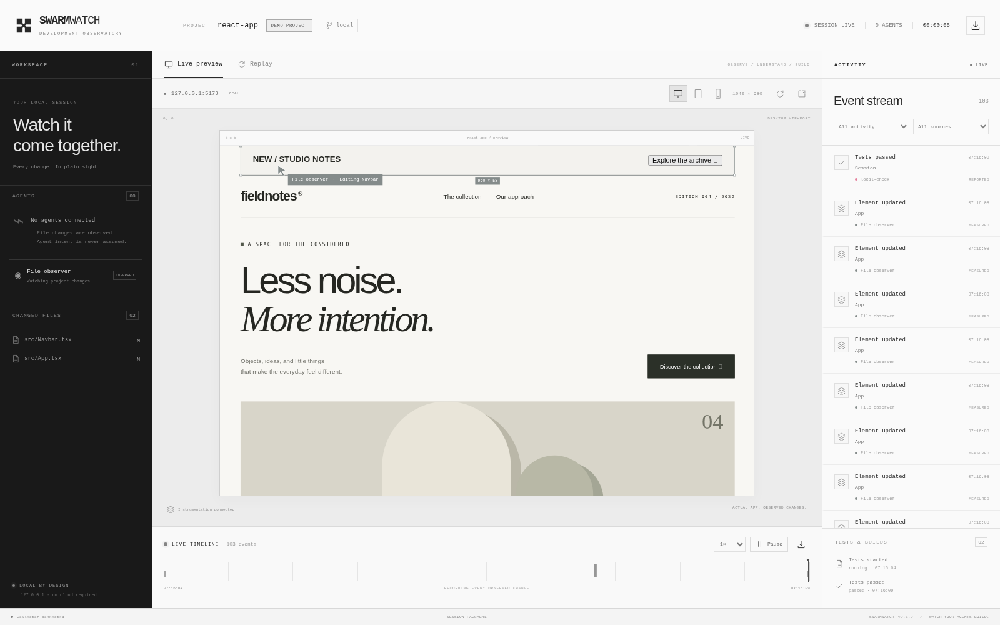

# SwarmWatch

**Watch your AI agents build a web application, live.**

React + Vite 앱의 실제 파일 변경과 HMR·DOM 변화를 연결해 작업 영역에 커서와 제작 애니메이션을 표시하는 로컬 개발 도구입니다. 원래 앱은 iframe에서 계속 실행되며, 확인되지 않은 AI 행동이나 가상의 작업자를 만들지 않습니다.

**0.1.0 MVP · Node.js 24+ · 로컬 실행 · MIT**

시각적 영감은 **[Joel Califa](https://github.com/califa)의 [Swarm](https://califa.github.io/swarm-site/)**, 참고 프로젝트는 **[Dhvanil / @DhvanilPatel](https://github.com/DhvanilPatel)의 [Swarm Rebuild](https://github.com/DhvanilPatel/swarm-cursors)**입니다. 원작의 코드·에셋을 포함하지 않은 독립 구현입니다. [원작자 및 출처](docs/credits.md) · [라이선스 구분](docs/third-party-notices.md)



## 설치 및 실행

현재 지원 배포 방식은 **전체 소스 체크아웃**입니다. npm에 게시된 패키지나 전역 `npx swarmwatch` 설치를 전제로 하지 않습니다.

```bash
git clone https://github.com/Duioolllll/swarm-ai-edit.git
cd swarm-ai-edit
npm ci
npm run build
npm run demo
```

대시보드는 `http://localhost:4317`, 실제 예제 앱은 `http://127.0.0.1:5173`에서 실행됩니다. 기본 바인딩은 `127.0.0.1`입니다. `Ctrl+C`로 시작한 프로세스를 종료합니다.

Demo는 배지가 표시되는 실제 React 앱입니다. `examples/react-app/src/App.tsx`에 요소를 추가하거나 `src/style.css`를 수정하면 HMR과 관측 애니메이션이 발생합니다. 초기 화면이나 예제 데이터를 AI 작업으로 꾸미지 않습니다.

운영 환경 준비, 업데이트·롤백과 데이터 보관은 [배포 가이드](docs/deployment.md)를 보세요. 파일 시스템과 로컬 개발 서버가 필요한 Node 앱이며 정적 웹사이트 호스팅 대상이 아닙니다.

## 주요 기능

| 기능 | 현재 지원 범위 |
| --- | --- |
| 실제 Preview | React + Vite, Desktop / Tablet / Mobile |
| 변경 시각화 | 실제 HMR 구간의 DOM 생성·텍스트·스타일·이미지·삭제, 측정한 요소 좌표 |
| 커서 | 에이전트별 독립 큐, 선택·사각형·타이핑·이미지 trace |
| 에이전트 수집 | Codex `exec --json`, OpenCode v1 SSE, 일반 파일 감시 fallback |
| 기록 | SQLite 세션, 중복 제거, WebSocket 연결 복구, JSON export |
| Replay | 시간 탐색, 일시정지·재개, 1×/2×/4×, 종류·에이전트 필터 |

파일만 관찰한 작업은 **File observer / inferred**로 구분합니다. 정확한 대상이나 에이전트를 모르면 특정 컴포넌트나 AI 의도를 임의로 지목하지 않습니다. 일반 앱 클릭·입력은 개발 작업 시각화에서 제외합니다.

## 내 프로젝트 연결

빌드된 SwarmWatch 체크아웃의 plugin을 대상 앱에 설치하세요.

```bash
cd /absolute/path/my-app
npm install -D /absolute/path/swarm-ai-edit/packages/vite-plugin
```

```ts
// 대상 앱의 vite.config.ts
import { defineConfig } from 'vite';
import react from '@vitejs/plugin-react';
import { swarmwatch } from '@swarmwatch/vite-plugin';

export default defineConfig({
  plugins: [swarmwatch(), react()],
  server: { host: '127.0.0.1', port: 5173, strictPort: true },
});
```

```bash
# SwarmWatch 체크아웃에서 실행 — 대상 앱의 개발 서버까지 시작
node packages/cli/dist/index.js dev --project /absolute/path/my-app \
  --url http://127.0.0.1:5173 -- npm run dev

# 기존 서버에 연결
node packages/cli/dist/index.js dev --project /absolute/path/my-app \
  --url http://127.0.0.1:5173
```

대시보드의 **Instrumentation connected**로 bridge 연결을 확인하세요. 에이전트·포트·검사 명령 옵션은 [상세 사용법](docs/usage.md#cli와-에이전트)에 있습니다. Codex/OpenCode는 별도 설치·인증이 필요하며 일반 파일 모드에는 API 키가 필요하지 않습니다.

## 검증

```bash
npm run build
npm run typecheck
npm test
npm run test:e2e
```

브라우저 테스트는 기본 `/usr/bin/chromium` 또는 `CHROMIUM_PATH`를 사용합니다. [브라우저 준비](docs/deployment.md#검증용-브라우저)를 참고하세요.

**파일 생성 → Vite HMR → 실제 Navbar → DOM 이벤트 → 해당 영역 커서**, CSS·텍스트 수정, Pause/Resume, 재연결, 저장·Replay를 검사합니다. 모듈/브리지 **28개**, Playwright 통합 **1개** 테스트가 통과했습니다. [검증 결과와 범위](docs/test-results.md)

[Live 화면](artifacts/swarmwatch-live.png) · [Replay 화면](artifacts/swarmwatch-replay.png) · [Mobile Preview](artifacts/swarmwatch-mobile-preview.png)

## 현재 제한

- Replay는 이벤트와 당시 측정 좌표를 재생합니다. 과거 HTML·CSS·미디어 snapshot은 없으며 iframe에는 현재 앱이 표시됩니다.
- 실제 인증된 Codex/OpenCode 작업은 미검증입니다. 공식 스키마 fixture와 mock SSE로 수집·재연결을 검증했습니다.
- CSS 연결과 파일·DOM 시간 상관관계는 추정이며 정확한 AI 인과관계의 증명이 아닙니다. full reload의 최초 화면은 새 baseline입니다.
- Next.js, 원격 Preview, Codex 협업 receiver thread의 개별 커서와 일반 npm 패키지 배포는 미지원입니다.
- 기본 데이터는 `<project>/.swarmwatch`에 저장합니다. 비밀 경로·입력 필드는 제외하지만 일반 DOM 텍스트가 기록될 수 있습니다. 민감 영역은 `data-sw-private`로 제외하고 export 전에 내용을 확인하세요.

## 문서

[상세 사용법](docs/usage.md) · [배포 가이드](docs/deployment.md) · [변경 기록](CHANGELOG.md) · [아키텍처](docs/architecture.md) · [Adapter 개발](docs/adapters.md) · [공식 인터페이스 조사](docs/adapter-research.md) · [참고 프로젝트 분석](docs/reference-analysis.md)

## 원작자와 라이선스

- **Joel Califa / [@califa](https://github.com/califa)** — [Swarm](https://califa.github.io/swarm-site/), 멀티 커서·제작 모션 콘셉트의 원작자. [원본 저장소](https://github.com/califa/swarm-site)
- **Dhvanil / [@DhvanilPatel](https://github.com/DhvanilPatel)** — [Swarm Rebuild / swarm-cursors](https://github.com/DhvanilPatel/swarm-cursors), 페이지 DOM 스냅샷·재구성 참고 프로젝트 제작자.
- **[Duioolllll](https://github.com/Duioolllll) 및 SwarmWatch contributors** — 실제 개발 이벤트를 연결하는 본 프로젝트의 독립 구현.

SwarmWatch 자체 코드는 [MIT License](LICENSE)로 제공합니다. 참고 프로젝트에는 조사 시점에 명시적인 재사용 라이선스가 없었으며, 이 저장소의 MIT는 원작의 재사용 권한을 부여하지 않습니다. 코드·에셋을 복사하지 않았으며 원작자와의 제휴나 보증을 의미하지 않습니다. [Credits](docs/credits.md) · [Third-party notices](docs/third-party-notices.md)
