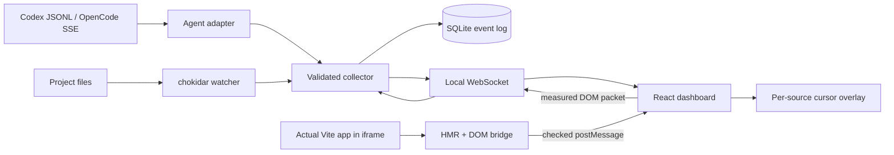

# SwarmWatch 아키텍처

SwarmWatch는 실제 개발 과정을 관찰하는 로컬 monorepo입니다. 참고 확장의 일회성 페이지 재구성 엔진과 달리 원래 앱의 DOM·상태·스크립트를 유지하고 외부 overlay만 애니메이션으로 표시합니다. 참고 코드·에셋은 재사용하지 않았습니다. [분석 근거](reference-analysis.md)를 보세요.

## 모듈 경계

| 경로 | 책임 |
| --- | --- |
| `packages/core/src/index.ts` | Zod event/DOM schema, 타입, 경로·metadata 필터, 상태와 identity별 bounded FIFO |
| `packages/server/src/watcher.ts` | realpath로 제한한 파일 감시, 초기 파일·symlink·비밀 경로 제외 |
| `packages/server/src/collector.ts` | 이벤트 검증, 중복 제거, 파일/DOM 시간·소스 연결 |
| `packages/server/src/store.ts` | SQLite WAL, 세션, event ID uniqueness, 증가 sequence |
| `packages/server/src/index.ts` | loopback HTTP, 정적 dashboard, read-only API, WebSocket 인증·복구 |
| `packages/vite-plugin/src/index.ts` | development JSX transform, source attribute, bridge script, Vite HMR hook |
| `packages/vite-plugin/src/client.ts` | DOM snapshot 차이, MutationObserver/ResizeObserver, HMR burst, 부모 통신 |
| `packages/cli/src/index.ts` | 인수 검증, child process 시작·종료, 명시적 test/build 실행, adapter 연결 |
| `packages/cli/src/adapters.ts` | Codex 공식 JSONL/OpenCode v1 SSE에서 allowlist 이벤트로 변환 |
| `apps/dashboard/src/main.tsx` | iframe, 상태·출처 표시, cursor scheduling, timeline, event replay |

## 라이브 파이프라인

1. CLI가 허용 프로젝트의 realpath와 loopback Preview URL을 검증하고 SQLite 세션·로컬 서버를 만듭니다. 선택적으로 개발 서버·Codex를 시작하거나 OpenCode SSE를 구독합니다. 기존 개발 서버는 소유하지 않습니다.
2. watcher는 초기 scan 후 새 변경만 발행합니다. 원본 파일 내용은 읽어 이벤트에 보관하지 않습니다. 에이전트 없는 변경은 항상 `file-observer / inferred`입니다.
3. Vite plugin은 `serve`에서만 JSX의 실제 DOM tag에 파일·컴포넌트·노드 ID attribute를 추가합니다. 소스 파일을 수정하지 않고 sourcemap을 반환합니다. component invocation에는 DOM attribute를 직접 추가하지 않습니다.
4. bridge가 최초 React render를 baseline으로 측정합니다. initial render를 생성 작업으로 표시하지 않습니다. 이후 DOM·스타일·직접 텍스트·미디어와 geometry를 비교합니다.
5. `vite:beforeUpdate`와 `vite:afterUpdate`가 HMR burst ID와 제한된 관찰 구간을 엽니다. 일반 입력은 구간을 닫고 baseline을 갱신합니다. scroll/resize는 위치 baseline만 바꾸며 작업을 만들지 않습니다. HMR가 없는 DOM delta는 애니메이션 이벤트로 승격하지 않습니다.
6. bridge는 configured parent origin, parent Window와 nonce를 확인하고 DOM packet을 전송합니다. dashboard는 iframe Window·preview origin·nonce를 다시 검사하고 Zod 검증 뒤 local WebSocket으로 전달합니다. 교차 출처 DOM을 직접 읽지 않습니다.
7. WebSocket 입력은 200ms settling 구간을 거쳐 100ms watcher debounce가 완료되도록 합니다. collector는 HMR ID, 시간과 파일 mapping을 검사합니다. 정확한 instrumented source가 있으면 같은 파일 이벤트와 연결하고, 더 최근 CSS 변경은 명시적으로 추정 연결합니다. HMR가 watcher보다 먼저 완료되는 race는 추가로 2초 bounded buffer로 대기합니다. 매칭되지 않으면 버립니다.
8. 확정된 이벤트가 SQLite에 저장된 후 브라우저로 전송됩니다. overlay는 측정한 사각형 위에서 source별 큐로 실행됩니다. 원래 앱의 DOM을 비우거나 타이핑을 위해 수정하지 않습니다. SVG pointer·선택 테두리·텍스트 trace는 별도 레이어입니다.

HMR 구간과 파일 mapping은 상관관계를 좁힐 뿐 정확한 AI 원인을 증명하지 않습니다. `confidence=measured`는 geometry와 DOM delta를 실측했다는 의미입니다. 파일 작성자와 CSS 연결은 `metadata.reason`·`metadata.mapping`으로 한계를 보존합니다. 대상을 모르면 임의 컴포넌트를 선택하지 않습니다.

## 이벤트·저장·복구

필수 event 필드는 eventId/sessionId/agentId/timestamp/eventType/status/source/confidence/metadata이며 filePath/componentName은 선택입니다. 전체 계약은 [Adapter 가이드](adapters.md)와 core schema에 있습니다. Store는 전역 증가 sequence를 부여하고 eventId uniqueness로 중복을 제거합니다. timestamp는 관찰 시각이며 race 복구 때문에 sequence와 시간 순서가 다를 수 있습니다. 연결 복구에는 sequence를, Replay에는 시간 정렬을 사용합니다.

SQLite 기본 위치는 `<project>/.swarmwatch/sessions.sqlite`입니다. 이 디렉터리는 watcher에서 제외됩니다. 이벤트·세션·측정 geometry만 저장하고 과거 HTML/CSS/screenshot은 저장하지 않습니다. Replay는 현재 iframe 위에서 저장된 이벤트를 설명하는 방식이며 당시 화면을 복원하지 않습니다. export도 `historicalDom:false`를 포함합니다.

Dashboard WebSocket이 끊기면 마지막 받은 sequence 이후를 다시 요청합니다. OpenCode의 upstream SSE는 별도 수명이며 durable catch-up이 없어 gap을 알립니다. 프로세스·열린 socket은 저장된 환경 snapshot에 포함되지 않으므로 새 작업에서는 CLI를 다시 실행해야 합니다.

## 로컬 API

| 인터페이스 | 응답/역할 |
| --- | --- |
| `GET /api/state` | 현재 session, project, preview URL, 로컬 WS token, 이벤트 |
| `GET /api/sessions` | 저장된 세션 목록 |
| `GET /api/sessions/:id/events` | sequence 순서 이벤트 |
| `GET /api/sessions/:id/export` | format/session/historicalDom/events |
| `/ws?token=…&sessionId=…&after=N` | `{type:'events',events:[…]}` 및 catch-up |
| WS client `{type:'dom',changes:[…]}` | 현재 세션의 검증된 DOM 관찰만 입력 |

쓰기 HTTP API나 임의 명령 실행 API는 없습니다. CLI 명령은 사용자가 명시적으로 전달한 경우 로컬 child process로 실행됩니다.

## 보안과 개인정보

- 서버는 `127.0.0.1`에만 바인딩합니다. exact Host·Origin allowlist와 random capability token을 검증합니다. HTTP는 GET만 허용하고 WebSocket은 Origin이 필수입니다. dashboard CSP는 자기 script와 지정 preview만 허용합니다.
- watcher와 adapter는 realpath·상대 경로·symlink 탈출·민감한 파일을 검사합니다. `.env*`, credentials/secrets, private keys, `.git`, `node_modules`, build output은 제외합니다.
- agent 메시지·reasoning·프롬프트·raw command·출력을 수집하지 않습니다. 제한된 metadata만 사용하고 크기/깊이·비밀 패턴을 필터링합니다.
- bridge는 input/textarea/select/contenteditable와 `data-sw-private` 영역을 제외합니다. 일반 DOM의 직접 텍스트는 이벤트에 포함될 수 있고 redaction은 모든 비밀을 찾지 못합니다. export는 사용자가 확인해야 합니다.
- preview 앱의 개발 서버 자체 노출·CSP·코드는 그 앱의 책임입니다. SwarmWatch는 remote URL 또는 임의 origin에 접근 권한을 부여하지 않습니다.

## 제한과 성능

한 세션은 최대 100,000 이벤트, recent file correlation은 300개, DOM dedup은 4,000개, HMR race buffer는 200개/2초로 제한합니다. WebSocket packet은 128KiB, DOM packet은 최대 50 delta, 초당 message 제한이 있으며 1MiB 이상 전송 backlog는 연결을 닫고 sequence 기반 재연결을 유도합니다. source별 animation FIFO도 bounded입니다. 같은 HMR 구간의 파일·컴포넌트·작업 종류별 관측을 대표 애니메이션으로 묶어 새 컴포넌트가 하위 요소 이벤트에 밀리지 않게 합니다. 별도 에이전트 큐는 독립적이며 원본 이벤트는 모두 기록합니다.

bridge는 최대 2,500 요소를 측정하고 80ms로 batching합니다. 한 측정의 최대 100 delta를 최대 50개씩 전송합니다. 큰 변경은 일부 overlay를 생략할 수 있지만 실제 앱과 파일 이벤트는 유지됩니다. computed style 측정과 DOM diff는 페이지 규모에 영향을 받습니다. 대규모 앱의 완전한 성능 보장은 하지 않습니다.

React + Vite JSX와 HMR를 우선 지원합니다. full reload는 새로운 baseline이며 초기 화면 작업을 복원하지 않습니다. arbitrary framework mapping, Next.js, shadow DOM 내부의 완전한 추적, historical screenshot replay, Codex 협업 receiver 연결, 전체 test runner 결과 파싱은 미지원입니다. adapter의 fixture/mock 검증은 실제 provider 인증 실행 검증과 구분합니다.
