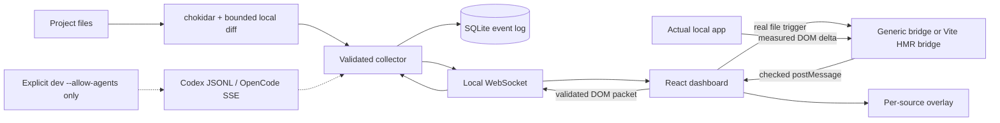

# SwarmWatch 아키텍처

SwarmWatch는 **프레임워크 독립 파일 관찰 + 선택적 실제 DOM 관찰** 도구입니다. 기본 경로는 모델을 호출하지 않고 deterministic local diff를 계산합니다. 시각화는 원래 앱을 iframe에서 계속 실행하며 별도 overlay만 사용합니다. 참고 프로젝트의 페이지 재구성 엔진·코드·에셋은 포함하지 않았습니다. [분석](reference-analysis.md) · [출처](credits.md)

## 모듈과 빌드 순서

| 경로 | 책임 |
| --- | --- |
| `packages/core/src/index.ts` | event/DOM Zod schema, 경로·metadata 검증, 상태, bounded FIFO |
| `packages/bridge/src/client.ts` | framework-free DOM 측정·차이, MutationObserver/ResizeObserver, parent 통신, generic/HMR mode |
| `packages/bridge/src/index.ts` | self-contained classic script 직렬화, 정확한 loopback origin alias |
| `packages/server/src/analyzer.ts` | bounded 파일 snapshot·hash, 로컬 line diff, metadata만 반환 |
| `packages/server/src/watcher.ts` | 초기 scan baseline, 파일 감시, coalescing/backpressure, analyzer 수명 |
| `packages/server/src/collector.ts` | 공통 검증, 이벤트 중복 제거, 파일·DOM correlation, 출처·한계 설명 |
| `packages/server/src/store.ts` | SQLite WAL, session, event ID uniqueness, 증가 sequence |
| `packages/server/src/index.ts` | HTTP/dashboard, `/bridge.js`, capability WebSocket, catch-up |
| `packages/vite-plugin/src/index.ts` | 선택적 serve-only JSX mapping, 공통 bridge를 HMR mode로 설치 |
| `packages/cli/src/options.ts` | 서버·child 시작 전 mode/URL/agent 옵션 검증 |
| `packages/cli/src/index.ts` | 서버·명시적 child 수명, 선택적 검사·adapter 연결 |
| `packages/cli/src/adapters.ts` | 공식 Codex JSONL/OpenCode v1 SSE allowlist 변환 |
| `apps/dashboard/src/main.tsx` | Preview 없는 관찰도 지원, file-control 전송, source별 animation, Replay |

`npm run build`: **core → bridge → server → Vite plugin → CLI → dashboard**. 서버는 dashboard의 checkout 상대 경로와 빌드된 bridge를 사용하므로 현재 배포 단위는 전체 저장소입니다.

## 기본 no-AI 경계

`watch --project PATH`는 URL 없이 시작할 수 있습니다. React·Vite·API 키를 요구하지 않습니다. `--codex`, `--opencode`, `--allow-agents`는 서버·child·adapter를 시작하기 전에 거부합니다. 호환 `dev`도 provider 옵션에 `--allow-agents`가 필요하며 `SWARMWATCH_NO_AI=1`이면 opt-in을 거부합니다. 기본 경로에서는 agent adapter를 동적으로 import하거나 공급자에 연결하지 않습니다.

명시적인 `--` 개발 명령, test/build command는 사용자가 전달한 로컬 child process입니다. 그 명령이나 앱 자체·별도 AI 도구가 발생시키는 API 사용은 이 경계 밖입니다. SwarmWatch의 기본 관찰이 모델을 호출하지 않는다는 것이 시스템 전체의 토큰 사용을 차단한다는 뜻은 아닙니다.

## 파일 관찰과 로컬 diff

초기 scan은 baseline을 만들고 새로운 변경만 `file-observer / file-watcher / inferred`로 발행합니다. 지원 확장자는 script·markup·style·Vue/Svelte/Astro·서버 template·data·asset이며 framework AST나 compiler 실행이 필요하지 않습니다. 정확한 목록은 [파일 관찰](file-watch.md)에 있습니다.

분석기는 파일당 256KiB, 보관 텍스트 합계 16MiB, 10,000 entry를 기본 한도로 둡니다. 파일은 realpath·regular-file·inode/device·symlink 조건을 확인한 뒤 한도만 읽습니다. snapshot과 hash는 프로세스 메모리 안에서만 쓰며 분석 결과에는 언어·종류, byte 수, 추가·삭제 line 수와 계산 방법·한계만 포함합니다. 원문 snippet·diff·hash는 SQLite로 전달하지 않습니다.

line diff는 공통 prefix/suffix를 줄이고 LCS를 제한된 작업량으로 계산합니다. `exact-line-diff`는 정확한 line 수이며 1,000,000 cell 초과 시 `whole-file-replacement` fallback을 명시합니다. 파일 한도·binary·snapshot budget·baseline 부재 등은 `unavailable`과 `null` line 수입니다. asset은 byte/hash 증거만 사용합니다. watcher는 2,000개 파일까지 pending queue를 병합하고 overflow를 보고합니다.

## 범용 Preview 파이프라인

1. 선택적 `--url`은 실제 실행 중인 local HTTP 앱을 iframe으로 표시합니다. URL이 없으면 파일 분석 대시보드만 제공합니다. SwarmWatch는 임의 앱을 자동 감지해 개발 runtime을 설치하지 않습니다.
2. 사용자는 개발 HTML/layout에 ``를 직접 추가합니다. 서버는 공통 bridge를 `mode:file-change` classic script로 제공하며 source 자동 주입은 없습니다.
3. 최초 화면을 baseline으로 측정합니다. bridge는 DOM 요소·직접 텍스트·일부 computed style·image·geometry의 실제 차이를 비교합니다. source 파일을 알 수 없는 요소는 `unknown`, 명시적인 `data-sw-file`은 opt-in mapping입니다.
4. dashboard는 현재 연결 뒤에 관찰된 최신 실제 파일 이벤트만 검증된 `file-change` control로 iframe에 전송합니다. control에는 event ID, 파일 경로, timestamp와 nonce가 있습니다. Replay·연결 catch-up을 새로운 라이브 개발 trigger로 사용하지 않습니다.
5. bridge는 parent Window·정확한 origin·nonce, 안전한 경로, timestamp freshness·중복 ID를 확인하고 짧은 관찰 구간을 엽니다. DOM이 파일 알림보다 먼저 바뀌는 race는 최대 100개의 delta를 500ms 이내 pending buffer로 보관합니다. file control 없이 DOM delta만으로 발행하지 않습니다.
6. 반환 DOM packet을 dashboard가 iframe Window·preview origin·nonce·schema로 검증합니다. WebSocket은 200ms settling 후 collector로 전달합니다. collector는 triggerEventId가 실제 최근 watcher 이벤트인지 다시 검증합니다.
7. source가 없는 generic correlation은 **추정**입니다. DOM geometry와 변화는 실측하지만 어느 파일이 어떤 요소의 원인이었는지 또는 누가 작성했는지 증명하지 못합니다. source를 모르면 모델로 보충하지 않습니다.

trusted 입력은 관찰 구간·pending을 취소합니다. scroll/resize는 baseline만 바꿉니다. full reload는 새 문서 baseline이므로 초기 화면을 생성 애니메이션으로 꾸미지 않습니다. bridge가 앱의 HMR·갱신 runtime을 대신하지 않습니다. Plain HTML 예제는 별도 작은 polling runtime으로 `content.html`을 실제 DOM에 반영해 범용 관찰을 검증합니다.

## 선택적 Vite 계측

Vite plugin은 `serve` transform에서 실제 JSX DOM tag에 `data-sw-file`, component, node ID를 삽입하고 sourcemap을 반환합니다. source 파일·component invocation을 직접 수정하지 않으며 production build에는 적용하지 않습니다. 공통 bridge를 `hmr` mode로 사용하고 `vite:beforeUpdate`·`vite:afterUpdate`를 HMR burst에 연결합니다.

collector는 burst ID·시간·파일 mapping을 검사합니다. instrumented source와 같은 파일 이벤트를 연결하거나 더 최근 CSS 변경을 추정 연결합니다. HMR가 watcher보다 빠른 경우 200ms settling과 2초 bounded race buffer를 사용하고 매칭되지 않으면 버립니다. HMR 구간에서도 exact causation을 보장하지 않습니다. `confidence:measured`는 DOM delta·geometry의 실측이고 작성자·mapping 한계는 metadata에 별도로 보존합니다.

범용 script와 Vite plugin은 동시에 설치하지 않습니다. 둘 다 실제 앱을 유지하고 SVG pointer·선택·텍스트·이미지 trace를 외부 overlay에서 실행합니다. 대상을 모르면 임의 컴포넌트를 고르지 않습니다.

## 이벤트·저장·복구

eventId/sessionId/agentId/timestamp/eventType/status/source/confidence/metadata가 공통 계약이며 filePath/componentName은 선택입니다. [Adapter 계약](adapters.md)과 core schema가 기준입니다. `source:agent-hook`는 공식 agent transport를 뜻하며 universal hook API의 존재를 뜻하지 않습니다.

Store는 증가 sequence와 eventId uniqueness로 순서·중복을 관리합니다. race 때문에 timestamp와 sequence 순서가 다를 수 있습니다. 연결 복구는 sequence, Replay는 시간 정렬과 sequence tie-break를 사용합니다. 기본 `<project>/.swarmwatch/sessions.sqlite`는 watcher에서 제외됩니다.

SQLite에는 이벤트·로컬 분석 metadata·측정 geometry만 저장합니다. 과거 HTML/CSS/image snapshot이 없어 Replay는 당시 화면을 복원하지 않습니다. iframe은 현재 앱이고 export는 `historicalDom:false`입니다. dashboard의 마지막 sequence 이후 기록은 복구하지만, 선택적 OpenCode upstream SSE gap의 durable catch-up은 보장하지 않습니다.

## 로컬 API와 안전

| 인터페이스 | 역할 |
| --- | --- |
| `GET /api/state` | session, project, 선택 preview URL, token, mode/aiEnabled, 이벤트 |
| `GET /bridge.js` | framework-free classic DOM bridge; 추가 데이터 API 권한 없음 |
| `GET /api/sessions` | 저장된 세션 |
| `GET /api/sessions/:id/events` 또는 `/export` | 순서 이벤트·JSON export |
| `/ws?token=…&sessionId=…&after=N` | 이벤트·catch-up, 현재 session DOM 관찰만 입력 |

서버는 `127.0.0.1` 바인딩, exact Host/Origin, WS의 필수 Origin·random capability를 사용합니다. `/bridge.js`만 지정 preview origin의 로딩을 허용하며 전체 API에 CORS를 열지 않습니다. HTTP는 GET이며 임의 명령 실행 endpoint가 없습니다. dashboard CSP와 bridge의 Window·origin·nonce 검증으로 교차 출처 DOM 직접 접근을 피합니다.

민감 경로·symlink 탈출은 제외합니다. agent raw message·prompt·reasoning·command/output은 저장하지 않습니다. bridge는 input/textarea/select/contenteditable와 `data-sw-private` 영역을 제외합니다. 일반 DOM 직접 텍스트는 남을 수 있고 metadata redaction은 모든 비밀을 탐지하지 못합니다. 앱 개발 서버 자체의 노출·CSP·비용은 사용자가 관리합니다.

## 한계와 성능

한 세션 100,000 이벤트, recent file 300개, DOM dedup 4,000개, HMR race buffer 200개/2초로 제한합니다. WebSocket payload는 128KiB, DOM packet은 최대 50개, 대기 DOM 200개와 message rate 제한이 있습니다. 전송 backlog 1MiB 이상은 연결을 닫고 sequence 재연결을 유도합니다. source별 animation FIFO와 대표 요소 batching으로 overlay 양을 제한합니다.

bridge는 최대 2,500 요소를 80ms batching으로 측정하고 한 측정 최대 100 delta를 보냅니다. 큰 변경은 일부 overlay를 생략할 수 있습니다. computed style·diff 비용은 페이지 규모에 영향을 받고 대규모 앱의 완전한 성능을 보장하지 않습니다.

framework-independent 파일 관찰과 DOM 측정은 framework별 compiler mapping과 다릅니다. Next.js 전용 자동 계측, shadow DOM 전체 추적, 과거 화면 복원, Codex 협업 receiver 연결, 전체 test assertion 파싱은 미지원입니다. 실제 인증 provider 실행은 fixture/mock 검증과 구분합니다. 프로세스·socket은 환경 snapshot에 남지 않아 새 작업에서 CLI를 다시 시작해야 합니다.
