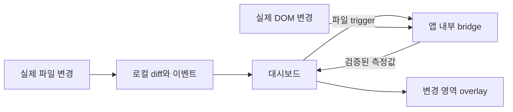

# 프레임워크 독립 파일 관찰

SwarmWatch의 기본 `watch` 모드는 **파일 감지와 로컬 diff 계산만 수행하며 LLM을 호출하지 않습니다.** React·Vite·Vue 등의 실행 환경이나 AI 공급자 인증이 없어도 파일 목록, 변경 통계, 세션 기록과 Replay를 사용할 수 있습니다. 파일 작성자가 AI인지 사람인지 추측해 에이전트를 만들어내지 않습니다.

## 파일만 관찰

Node.js 24 이상에서 저장소 루트를 기준으로 실행합니다.

```bash
npm ci
npm run build
node packages/cli/dist/index.js watch --project /absolute/path/my-app
```

출력된 로컬 대시보드를 여세요. 기본 포트는 `4317`입니다. URL을 지정하지 않으면 Preview 서버 없이 파일 관찰만 시작합니다. 최초 파일 scan은 baseline이며 새 작업으로 표시하지 않습니다. 그 뒤 실제 파일을 생성·수정·삭제하면 이벤트가 기록됩니다.

이미 실행 중인 앱도 함께 보려면:

```bash
node packages/cli/dist/index.js watch --project /absolute/path/my-app \
  --url http://127.0.0.1:5173
```

개발 서버까지 시작하려면 `--` 뒤에 명시적으로 명령을 전달합니다. 명령은 `--project` 디렉터리에서 실행됩니다.

```bash
node packages/cli/dist/index.js watch --project /absolute/path/my-app \
  --url http://127.0.0.1:5173 -- npm run dev -- --host 127.0.0.1
```

이 URL은 실제로 실행되는 서버와 일치해야 합니다. SwarmWatch가 프로젝트의 프레임워크를 추측해 설치하거나 실행하지 않습니다. `Ctrl+C`는 SwarmWatch가 시작한 프로세스를 종료하며 기존 서버는 종료하지 않습니다. 저장소의 `npm run dev`와 `npm run demo`도 `watch`를 사용합니다. `npm run demo:plain`은 React·Vite 없는 HTML 샘플을 5180에서 실행합니다. Demo 표시는 실제 샘플 관찰을 구분하며 가짜 활동을 생성하지 않습니다.

## AI 실행과 비용의 경계

`watch`는 `--codex`, `--opencode`, `--allow-agents`를 허용하지 않으며 프로세스를 시작하기 전에 거부합니다. 에이전트 연결이 필요하면 별도의 `dev` 명령에 `--allow-agents`를 명시해야 합니다. `SWARMWATCH_NO_AI=1` 환경 변수는 `dev`에서도 agent opt-in을 차단합니다. 기본 파일 관찰에서는 에이전트를 시작하거나 공급자에 연결하지 않습니다.

이 설명은 **SwarmWatch의 관찰·분석 기능**에 대한 것입니다. 사용자가 `--` 뒤에 전달한 개발 명령, 앱 자체의 API 호출, 이미 실행 중인 코딩 에이전트나 다른 도구는 별개로 토큰·요금을 사용할 수 있습니다. 프로젝트 전체의 AI 비용이 0이라고 보장하지 않습니다. 비용 없는 관찰을 원하면 별도 에이전트 옵션을 사용하지 말고 전달할 명령과 앱의 동작도 확인하세요.

## 지원 파일과 로컬 분석

파일 감지는 확장자를 기준으로 하며 특정 프레임워크 compiler를 요구하지 않습니다.

| 종류 | 지원 확장자 |
| --- | --- |
| Script | JS/JSX/TS/TSX 및 c/m 변형, PY, PYI, RB, GO, JAVA, KT, KTS, CS, FS, FSX, RS, EX, EXS, DART |
| Markup | HTML, HTM, XHTML, MD, Markdown, MDX |
| Style | CSS, SCSS, SASS, LESS, Styl, Stylus, PCSS, PostCSS |
| Template | Vue, Svelte, Astro, PHP, EJS, HBS, Handlebars, NJK, Nunjucks, Twig, ERB, EEX, HEEX, LEEX, Razor, CSHTML |
| Data | JSON, JSONC, YAML, YML, XML, TOML, GRAPHQL, GQL |
| Asset | SVG, PNG, JPG, JPEG, WebP, GIF, AVIF, ICO |

`metadata.analysis.engine`은 `local-diff`입니다. 저장하는 분석 정보는 파일 종류·언어, 변경 전후 byte 수, 추가·삭제 line 수, 계산 방식·제한 사유입니다. AST 의미 분석이나 모델의 코드 설명을 제공하지 않습니다.

- `counting: exact-line-diff`: 보관된 두 텍스트의 line 추가·삭제를 정확히 계산합니다.
- `counting: whole-file-replacement`: diff 작업량 한계를 넘으면 변경 블록을 교체한 것으로 세는 fallback입니다. 최소 line diff와 같다고 보장하지 않습니다.
- `counting: unavailable`: binary, 큰 파일, baseline 부재·메모리 제한 등으로 line 수를 계산할 수 없습니다. 이때 line 수는 `null`이며 0으로 꾸미지 않습니다. 사유는 `truncation`에 남습니다.

소스 비교를 위해 작은 파일의 snapshot을 **프로세스 메모리에서만** 제한적으로 읽습니다. 기본 한계는 파일당 256KiB, 보관 텍스트 합계 16MiB, snapshot entry 10,000개, diff 작업 1,000,000 cell입니다. source snippet·diff 원문·hash는 분석 이벤트나 SQLite에 저장하지 않습니다. asset은 byte/hash 기반 변경만 확인하며 line diff를 하지 않습니다. `.env*`, 비밀·키 파일, `.git`, `node_modules`, 빌드 출력과 symlink 탈출은 감시에서 제외합니다.

## 모든 로컬 웹 앱에 Preview 연결

파일 이벤트만으로 DOM 위치를 알아낼 수는 없습니다. 임의 프레임워크의 실제 화면 위에 애니메이션을 표시하려면 로컬 앱의 개발용 HTML 또는 공통 layout에 다음 **classic script**를 직접 추가하세요.

```html
<script src="http://127.0.0.1:4317/bridge.js"></script>
```

대시보드 포트를 변경했다면 script의 포트도 바꾸세요. 앱을 위의 `watch --url`로 연결하고 dashboard의 iframe에서 여세요. script는 프레임워크·module loader에 의존하지 않으며 SwarmWatch가 원본 파일에 자동 삽입하지 않습니다. CSP가 있다면 개발 환경에서 해당 로컬 script를 허용해야 합니다. 운영 배포에는 넣지 마세요.



bridge와 dashboard는 parent Window, 정확한 origin과 nonce를 검증합니다. 실제 서버가 관찰한 파일 trigger와 가까운 DOM delta가 함께 있어야 overlay가 나타납니다. 파일 이벤트만으로 임의 요소를 지목하거나 요소를 만들어내지 않습니다. 일반 앱 사용과 초기 render는 작업 애니메이션의 근거가 아닙니다.

범용 bridge의 DOM 위치는 실측하지만 **어느 소스 파일이 원인인지는 기본적으로 추정**입니다. 프레임워크별 compiler mapping을 자동 제공하지 않습니다. 명시적인 mapping을 원하면 실제 소유 파일을 아는 요소에만 상대 경로를 넣을 수 있습니다.

```html
<nav data-sw-file="templates/navbar.html" data-sw-component="Navbar">
  <!-- 실제 앱 내용 -->
</nav>
```

이 attribute는 사용자가 제공한 mapping이며 인과관계나 AI 작성자를 증명하지 않습니다. React + Vite에서는 기존 `@swarmwatch/vite-plugin`이 transform 시 JSX mapping과 HMR 정보를 제공하므로 더 정확한 파일 연결을 사용할 수 있습니다. 범용 bridge와 Vite plugin을 같은 페이지에 중복 삽입하지 마세요.

## 한계와 개인정보

범용 bridge는 앱을 대신 빌드하거나 HMR 기능을 추가하지 않습니다. 개발 서버가 HTML 전체를 reload하면 새 문서의 초기 화면은 새 baseline입니다. 그 화면을 과거 변경으로 복원하거나 생성 애니메이션으로 꾸미지 않습니다. DOM을 유지하며 갱신되는 변경을 관찰할 수 있고, 전체 reload만 가능한 앱에서도 파일 이벤트·로컬 분석은 계속 동작합니다.

DOM 관찰에는 화면의 직접 텍스트가 포함될 수 있습니다. 이는 source snippet 저장과 별개의 정보입니다. 민감한 영역에는 `data-sw-private`를 사용하세요. input/textarea/select/contenteditable는 제외하며 metadata redaction은 최선의 노력입니다. export 전에는 내용을 확인하세요.

세션과 측정 geometry는 로컬 SQLite에 보관합니다. Replay는 이벤트 이력을 재생하며 과거 HTML·CSS·이미지 snapshot을 복원하지 않습니다. Preview는 현재 앱입니다. 코드의 의미·에이전트의 내부 의도·정확한 과거 화면을 LLM으로 보충하지 않습니다.
