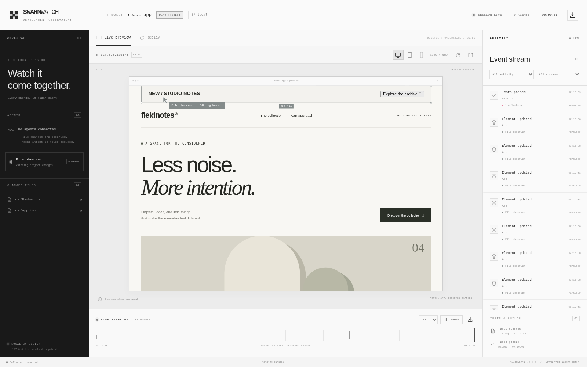

# SwarmWatch

**Watch your AI agents build a web application, live.**

React + Vite 앱의 파일 변경과 실제 HMR·DOM 변화를 연결해, 해당 요소 위에 커서와 선택·타이핑 애니메이션을 표시하는 로컬 개발 도구입니다. 원래 앱은 iframe 안에서 계속 실행됩니다. 전체 페이지를 가짜 화면으로 교체하지 않습니다.

파일 관찰 모드에는 가상의 AI가 나타나지 않습니다. 회색 **File observer / inferred**는 작성자를 모르는 파일 변경이고, Codex·OpenCode가 공식 이벤트로 보고한 작업은 별도 출처로 표시합니다. DOM의 위치는 실측하지만, 시간상 연결이 정확한 AI 인과관계를 증명하지는 않습니다.

## 빠른 실행

필수: **Node.js 24 이상**, npm. SQLite는 Node 내장 `node:sqlite`를 사용합니다. 처음 실행할 때 실험적 SQLite 안내가 출력될 수 있습니다.

저장소 루트에서:

```bash
npm ci
npm run build
npm run dev
```

터미널에 출력된 대시보드 주소를 여세요. 기본 포트는 **4317**, 샘플 앱은 **5173**입니다. 두 서버는 `127.0.0.1`에 바인딩합니다. `Ctrl+C`는 SwarmWatch가 시작한 프로세스 그룹을 종료합니다.

샘플의 `examples/react-app/src/App.tsx`에 요소를 추가하거나 `src/style.css`의 버튼 스타일을 수정하면 실제 HMR 갱신과 관찰 애니메이션을 볼 수 있습니다. 앱 클릭에 따른 일반 상태 변경은 독립적인 개발 이벤트로 취급하지 않습니다.

명확한 Demo 표시로 샘플을 실행하려면:

```bash
npm run demo
```

Demo도 실제 파일 변경을 기다립니다. 에이전트나 테스트 성공 이벤트를 자동 생성하지 않습니다. 포트 5173이 이미 사용 중이면 기존 앱에 연결하거나 다른 `--url`과 개발 서버 포트를 함께 지정하세요.

## 기존 React + Vite 프로젝트 연결

현재는 소스 체크아웃에서 실행하는 버전입니다. npm에 배포된 패키지 또는 `npx swarmwatch`의 사용 가능성을 전제로 하지 않습니다.

1. 위 명령으로 SwarmWatch를 빌드합니다.
2. 대상 앱에서 로컬 plugin을 설치합니다. `/absolute/path/swarm-ai-edit`를 실제 체크아웃 경로로 바꾸세요.

```bash
cd /absolute/path/my-app
npm install -D /absolute/path/swarm-ai-edit/packages/vite-plugin
```

3. 대상 앱의 `vite.config.ts`에 plugin을 추가합니다.

```ts
import { defineConfig } from 'vite';
import react from '@vitejs/plugin-react';
import { swarmwatch } from '@swarmwatch/vite-plugin';

export default defineConfig({
  plugins: [swarmwatch(), react()],
  server: { host: '127.0.0.1', port: 5173, strictPort: true },
});
```

4. SwarmWatch가 개발 서버까지 시작하게 하거나, 이미 실행 중인 서버 URL을 지정합니다.

```bash
# SwarmWatch 저장소 루트에서, 대상 앱 디렉터리에서 npm run dev 실행
node packages/cli/dist/index.js dev --project /absolute/path/my-app \
  --url http://127.0.0.1:5173 -- npm run dev -- --host 127.0.0.1

# 기존 서버에 연결 — 그 서버는 종료 시에도 유지됨
node packages/cli/dist/index.js dev --project /absolute/path/my-app \
  --url http://127.0.0.1:5173
```

별도로 시작한 개발 서버와 기본값 외 대시보드 포트를 사용할 때는 plugin의 `dashboardOrigin`을 설정하세요. 예: `swarmwatch({ dashboardOrigin: ['http://127.0.0.1:4400', 'http://localhost:4400'] })`. 대시보드에서 **Instrumentation connected**가 보여야 DOM 애니메이션이 가능합니다. plugin이 없는 앱은 실제 Preview와 파일 이벤트만 지원합니다. iframe을 차단하는 CSP/X-Frame-Options는 대상 개발 서버에서 조정해야 합니다.

## CLI와 에이전트

`node packages/cli/dist/index.js --help`로 전체 도움말을 볼 수 있습니다.

| 옵션 | 의미 |
| --- | --- |
| `--project PATH` | 관찰할 디렉터리, 필수 |
| `--url URL` | loopback HTTP 개발 서버, 기본 `http://127.0.0.1:5173` |
| `--port NUMBER` | 대시보드 포트, 기본 4317 |
| `--data-dir PATH` | SQLite 저장 위치, 기본 `<project>/.swarmwatch` |
| `--codex PROMPT` | 설치·인증된 `codex exec --json PROMPT` 실행 및 JSONL 수집 |
| `--opencode URL` | 기존 OpenCode v1 로컬 서버의 프로젝트별 SSE 구독 |
| `--test-command COMMAND` | 명시적으로 지정한 로컬 테스트 명령 실행 및 exit status 기록 |
| `--build-command COMMAND` | 명시적으로 지정한 로컬 빌드 명령 실행 및 exit status 기록 |
| `--demo` | 실제 샘플 관찰 세션을 Demo로 표시 |
| `-- COMMAND ARGS...` | 대상 프로젝트 디렉터리에서 개발 서버 실행 |

```bash
# 인증과 Codex 설치는 사용자의 기존 환경을 사용
node packages/cli/dist/index.js dev --project ./my-app \
  --url http://127.0.0.1:5173 --codex 'Add an accessible Navbar component'

# 별도 터미널에서 시작한 OpenCode v1 서버에 읽기 전용 연결
opencode serve --hostname 127.0.0.1 --port 4096
node packages/cli/dist/index.js dev --project ./my-app \
  --url http://127.0.0.1:5173 --opencode http://127.0.0.1:4096

# 대상 프로젝트에 존재하는 실제 명령만 지정
node packages/cli/dist/index.js dev --project ./my-app \
  --url http://127.0.0.1:5173 --test-command 'npm test' --build-command 'npm run build'
```

`--test-command`와 `--build-command`는 전달한 명령을 실제로 실행합니다. 결과는 **그 프로세스의 종료 상태**이며 테스트 개수, assertion 성공 또는 0-test 여부를 파싱하지 않습니다. 테스트와 빌드는 독립적으로 시작될 수 있습니다. 비밀 값은 명령 문자열에 넣지 마세요.

Codex는 래퍼가 시작한 한 thread의 공식 JSONL을 지원합니다. 이미 실행 중인 interactive CLI에 자동 연결하거나 private session 저장소를 스캔하지 않습니다. Codex 협업 receiver thread들의 작업을 개별 커서로 연결하는 기능은 미지원입니다. OpenCode는 session ID가 있는 이벤트만 해당 ID로 연결합니다. `file.edited`처럼 session ID가 없는 upstream 이벤트는 **unassigned**로 남깁니다. OpenCode 인증은 기존 `OPENCODE_SERVER_PASSWORD`와 선택적 `OPENCODE_SERVER_USERNAME` 환경 변수를 사용합니다.

이 저장소의 자동화는 공식 스키마 fixture와 mock SSE로 adapter를 검증합니다. 실제 공급자 인증을 거친 Codex/OpenCode 실행은 검증하지 않았습니다. 지원 근거와 버전은 [공식 인터페이스 조사](adapter-research.md)를 보세요.

## 관찰·재생 범위

- Desktop / Tablet / Mobile Preview, 파일 목록, 이벤트 출처·신뢰도, 테스트·빌드 결과와 에이전트별 큐를 제공합니다.
- 라이브는 Vite HMR burst, 실제 DOM delta, 대응 파일 변경이 함께 있을 때만 대상을 애니메이션으로 표시합니다. HMR 구간에서 일어난 모든 변화를 완전하게 인과 분리할 수는 없습니다.
- JSX DOM 요소는 transform 시 삽입된 `data-sw-*`로 파일·컴포넌트를 연결합니다. 파일 원본은 수정하지 않습니다. CSS 변경의 소스 연결은 추정입니다.
- 전체 reload 후 최초 DOM은 새 baseline입니다. 그 초기 화면을 생성 작업으로 꾸미지 않습니다. HMR 가능한 변경을 우선 지원합니다.
- SQLite는 세션·순서 있는 이벤트·측정한 geometry를 저장합니다. WebSocket 재연결은 마지막 sequence 이후의 기록을 복구합니다. OpenCode upstream 연결이 끊긴 동안의 이벤트까지 복구한다고 보장하지 않습니다.
- Replay는 세션 선택, 탐색, 일시정지, 1×/2×/4×, 에이전트·종류 필터 및 JSON export를 제공합니다. **과거 HTML·이미지·CSS snapshot을 저장하지 않으므로 과거 화면을 재현하지 않습니다.** iframe은 현재 앱이고 geometry는 당시 측정값입니다. 화면에도 이 한계를 표시합니다.
- Next.js, 서버 프레임워크별 자동 plugin, 브라우저 확장, 임의 외부 사이트, 원격 preview는 지원하지 않습니다.
- watcher 대상 확장자: JS/TS/JSX/TSX 및 관련 c/m 변형, CSS/SCSS/SASS/LESS, HTML, JSON, SVG, PNG, JPEG, WebP, GIF. 초기 파일은 작업으로 보고하지 않습니다.

## 로컬 데이터와 안전

대시보드는 loopback 바인딩, Host·Origin 검사, WebSocket capability token과 payload·전송량 제한을 사용합니다. 감시 경로는 realpath로 확인하고 symlink를 따라가지 않습니다. HTTP에는 명령 실행 API가 없습니다. 개발 서버 자체의 바인딩·접근 정책은 사용자가 관리합니다.

`.env*`, credentials/secrets 파일, 키 파일, `.git`, `node_modules`, 빌드 출력 등을 제외하고 원본 파일 내용·프롬프트·명령 출력은 이벤트에 보관하지 않습니다. 다만 **DOM의 직접 텍스트는 로컬 이벤트에 포함될 수 있습니다.** metadata의 토큰·비밀번호 패턴 필터는 최선의 노력이며 모든 비밀을 식별하지 못합니다. 민감한 영역에 `data-sw-private`를 붙이세요. input/textarea/select/contenteditable 영역도 관찰에서 제외합니다.

세션 export 전에 내용을 확인하고 `.swarmwatch/`를 버전 관리에 포함하지 마세요. SwarmWatch는 세션을 외부 서비스로 업로드하지 않습니다.

## 검증

```bash
npm run build
npm run typecheck
npm test
npm run test:e2e
```

브라우저 검증은 Chromium이 필요합니다. 기본 실행 파일은 `/usr/bin/chromium`이고, 다른 설치 위치는 `CHROMIUM_PATH=/absolute/path/chromium`으로 지정합니다. `npm test`에도 실제 bridge 브라우저 테스트가 포함됩니다. E2E는 실제 파일 생성·수정·HMR·커서·재연결·Replay를 검사합니다. 최신 실행 결과는 [검증 결과](test-results.md)에 기록됩니다.

실제 Playwright 실행으로 생성한 스크린샷:

- [Live Preview](../artifacts/swarmwatch-live.png)
- [Mobile Preview](../artifacts/swarmwatch-mobile-preview.png)
- [Replay](../artifacts/swarmwatch-replay.png)



동작 GIF/영상은 아직 포함하지 않았습니다. 위 샘플을 실행해 실제 파일 변경 과정을 녹화한 뒤 `artifacts/swarmwatch-demo.webm` 또는 GIF로 저장하고 README에 링크할 수 있습니다. 녹화는 Demo 표시와 실제 이벤트 출처가 보이도록 하세요.

## 구조와 개발 문서

```text
packages/core          이벤트/DOM schema, redaction, 상태와 큐
packages/server        collector, chokidar, SQLite, HTTP/WebSocket
packages/vite-plugin   JSX source mapping, HMR·DOM bridge
packages/cli           프로세스 수명, Codex/OpenCode adapter
apps/dashboard         실제 Preview, overlay, timeline, Replay
examples/react-app     실제로 수정 가능한 React + Vite 앱
```

[아키텍처](architecture.md) · [Adapter 개발 가이드](adapters.md) · [참고 프로젝트 분석](reference-analysis.md) · [검증 결과](test-results.md)

참고한 `swarm-cursors`는 명시적인 재사용 라이선스가 없습니다. 공개 동작 원리를 조사했으며 원본의 코드·에셋·재구성 엔진을 복사하지 않았습니다. SwarmWatch는 실제 이벤트를 관찰하는 독립 구현입니다.
